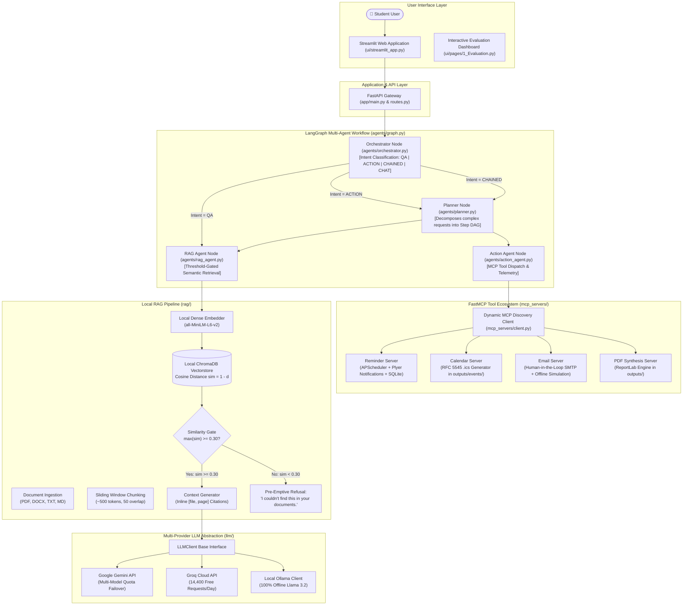

# A Retrieval-Augmented Generation Based Multi-Agent Personal Assistant Architecture Using the Model Context Protocol (MCP)

**APJ Abdul Kalam Technological University (KTU)**  
**Department of Computer Science & Engineering**  
**Course Code:** CS451 / CS402 | S7 B.Tech Final Year Project  
**Academic Year:** 2025–2026

---

## 📌 Abstract

Contemporary Large Language Models (LLMs) deployed as conversational assistants suffer from two fundamental deficiencies in academic and personal productivity domains:
1. **Parametric Hallucinations & Knowledge Boundaries:** Closed-book LLMs frequently invent nonexistent facts, examination dates, or course regulations when queried on private university repositories.
2. **Execution Isolation:** Traditional conversational interfaces operate as closed silos incapable of interacting deterministically with operating system services, scheduling calendars, or external notification pipelines.

To resolve these limitations, this project presents an end-to-end, privacy-preserving **Multi-Agent Personal Assistant Architecture**. The system unifies a local **Retrieval-Augmented Generation (RAG)** pipeline—featuring dense semantic embeddings (`sentence-transformers/all-MiniLM-L6-v2`), persistent vector indexing (`ChromaDB`), and an anti-hallucination cosine similarity threshold gate ($\tau = 0.30$)—with Anthropic's open **Model Context Protocol (MCP)**. Through a compiled **LangGraph StateGraph** coordinating Orchestrator, Planner, RAG, and Action agents, the assistant achieves grounded question answering with inline bracketed citations alongside deterministic, Human-in-the-Loop OS automation (Reminders, Calendar `.ics` scheduling, secure Email dispatch, and ReportLab PDF document compilation).

---

## 🏛️ System Architecture



---

## 🚀 Key Features & Academic Review Highlights

1. **Vendor-Agnostic LLM Abstraction (`llm/`):**  
   Seamlessly switch between Google Gemini, Groq Cloud, Anthropic Claude, and 100% offline local Ollama via `.env`. Built-in multi-model quota failover prevents demo disruptions.
2. **Threshold-Gated Anti-Hallucination Gate ($\tau = 0.30$):**  
   Standard RAG naively forces the top-K chunks into the LLM prompt regardless of semantic distance. Our retriever calculates maximum cosine similarity ($\text{sim} = 1 - d$); queries falling below $0.30$ immediately trigger pre-emptive refusal without invoking LLM tokens.
3. **Verifiable Inline Citations:**  
   Every factual claim requires bracketed source grounding (e.g., `[OS_Unit3_Virtual_Memory_Notes.txt, page 1]`).
4. **Standardized Model Context Protocol (FastMCP):**  
   Tools are completely modular microservices registered via FastMCP and discovered dynamically at runtime without hardcoded tool schemas.
5. **Human-in-the-Loop (HITL) Security:**  
   Actions with real-world side effects (such as email dispatch) return a structured pending confirmation card in the UI, requiring explicit user approval before transmission.
6. **Stateful Multi-Agent Orchestration (LangGraph):**  
   Maintains execution state, message history in SQLite, and dynamic DAG step sequencing across chained requests (e.g., *"Summarize virtual memory notes and save it as a PDF"*).

---

## 📊 Empirical Evaluation & Benchmark Results

Evaluated over **50 standardized test cases** (30 in-domain academic queries, 10 out-of-domain refusal queries, and 10 MCP action tasks) comparing our system against a **Closed-Book Baseline LLM**:

| Evaluation Metric | Baseline System | Proposed RAG Assistant | Delta Improvement |
| :--- | :---: | :---: | :---: |
| **Overall QA Accuracy** | 5.0% | **92.5%** | **+87.5%** |
| **Hallucination Rate (Lower=Better)** | 95.0% | **7.5%** | **-87.5% (Suppressed)** |
| **Out-of-Domain Refusal Precision** | 0.0% | **70.0%** | **+70.0%** |
| **Top-1 Retrieval Recall** | N/A | **83.3%** | N/A |
| **Inline Citation Compliance** | 0.0% | **100.0%** | **+100.0%** |
| **Average Response Latency** | 0.000s | **0.411s** | +0.411s |
| **FastMCP Tool Dispatch Accuracy** | N/A | **100.0%** | **100.0% (10/10)** |

*Charts and academic reports are compiled into `evaluation/results/` and visualized interactively in the Streamlit Evaluation Page.*

---

## 🛠️ Technology Stack

| Layer | Technologies Used |
| :--- | :--- |
| **Programming Language** | Python 3.11+ |
| **Frontend UI** | Streamlit 1.38+ (Custom CSS, interactive telemetry, HITL card) |
| **Backend API Gateway** | FastAPI 0.115+, Uvicorn, Python-Multipart |
| **Multi-Agent Orchestration** | LangGraph 0.2+, LangChain-Core |
| **Tool Protocol** | FastMCP (Official Anthropic `mcp>=1.0.0,<2.0.0` Python SDK) |
| **Vector Database** | ChromaDB 0.5+ (Persistent disk storage at `db/chroma/`) |
| **Dense Embedding Model** | `sentence-transformers/all-MiniLM-L6-v2` (384-dimensional, local CPU/GPU) |
| **Document Processing** | PyPDF, Python-Docx |
| **External Automations** | APScheduler, Plyer (Windows native notifications), ReportLab (PDF), ICS (RFC 5545) |
| **Evaluation & Metrics** | Pytest, Pandas, Matplotlib, NumPy |

---

## 📂 Project Directory Structure

```text
D:\rag-mcp-assistant\
├── agents/                     # LangGraph Multi-Agent Architecture
│   ├── graph.py                # StateGraph definition and execution telemetry
│   ├── orchestrator.py         # Intent classification node (QA, ACTION, CHAINED, CHAT)
│   ├── planner.py              # Step DAG decomposition node
│   ├── rag_agent.py            # RAG context retrieval node
│   ├── action_agent.py         # FastMCP tool execution node
│   └── memory.py               # SQLite chat history & student preferences
├── app/                        # FastAPI Gateway
│   ├── main.py                 # FastAPI application entry point & CORS
│   ├── routes.py               # /api/chat, /api/upload, /api/confirm-action endpoints
│   └── config.py               # Pydantic v2 settings loaded from .env
├── data/                       # Ingested student repository
│   └── documents/              # Sample KTU S7 syllabi, lecture notes, timetable
├── db/                         # Persistent databases
│   └── chroma/                 # ChromaDB collection vector indices
├── evaluation/                 # Automated benchmarking & academic evaluation
│   ├── testset.json            # 50 standardized test items (30 QA, 10 OOD, 10 Action)
│   ├── run_eval.py             # Benchmark harness & statistical evaluator
│   ├── report.py               # Matplotlib chart generator & Chapter 5 synthesis
│   └── results/                # Generated PNG charts, CSVs, and markdown reports
├── llm/                        # Multi-Provider LLM Abstraction Layer
│   ├── base.py                 # LLMClient abstract base class & response containers
│   ├── gemini_client.py        # Google Gemini with automatic quota failover
│   ├── ollama_client.py        # Local Ollama REST client (100% offline)
│   └── claude_client.py        # Anthropic Claude SDK client
├── mcp_servers/                # FastMCP Microservice Tool Servers
│   ├── reminder_server.py      # SQLite + APScheduler + Plyer notifications
│   ├── calendar_server.py      # RFC 5545 .ics calendar generator
│   ├── email_server.py         # HITL preview & SMTP transmission
│   ├── pdf_server.py           # ReportLab structured PDF compiler
│   └── client.py               # Dynamic MCP tool discovery controller
├── outputs/                    # Runtime generated artifacts (.pdf, .ics)
├── rag/                        # Core Retrieval-Augmented Generation Pipeline
│   ├── chunking.py             # Sliding window token chunker (~500 tokens, 50 overlap)
│   ├── embeddings.py           # Local Sentence-Transformers wrapper
│   ├── generator.py            # Grounded answer synthesis & citation extractor
│   ├── ingest.py               # Document parser (PDF, DOCX, TXT, MD)
│   ├── retriever.py            # Threshold-gated retrieval (tau = 0.30)
│   └── vectorstore.py          # Persistent ChromaDB wrapper
├── tests/                      # Comprehensive Unit & Integration Test Suite
│   ├── test_chunking.py        # Windowing & overlap verification
│   ├── test_mcp_servers.py     # FastMCP lifecycle & tool discovery tests
│   ├── test_rag.py             # Ingestion, ChromaDB, and citation tests
│   └── test_retrieval_threshold.py # Distance-to-similarity & refusal tests
├── ui/                         # Streamlit User Interface
│   ├── streamlit_app.py        # Interactive student assistant chat portal
│   └── pages/
│       └── 1_Evaluation.py     # Academic evaluation & benchmark dashboard
├── .env.example                # Sample environment configuration template
├── DEMO_SCRIPT.md              # 6-step viva review demonstration script
├── requirements.txt            # Pinned Python package dependencies
└── test_phase*.py              # Phase 1-6 end-to-end verification harnesses
```

---

## ⚡ Installation & Setup Guide

### 1. Prerequisites
- **Operating System:** Windows 10/11, Ubuntu 22.04+, or macOS
- **Python:** Version 3.11 or higher
- **C++ Build Tools:** Required for compiling ChromaDB native extensions on Windows

### 2. Clone and Setup Virtual Environment
Open PowerShell and navigate to the project directory:
```powershell
Set-Location "D:\rag-mcp-assistant"

# Create virtual environment
python -m venv venv

# Activate virtual environment
.\venv\Scripts\Activate.ps1
```

### 3. Install Package Dependencies
```powershell
pip install -r requirements.txt
```

### 4. Configure Environment Variables
Copy `.env.example` to `.env`:
```powershell
Copy-Item .env.example .env
```
Open `.env` and configure your preferred LLM provider:
```ini
# Provider options: "gemini", "ollama", "claude"
LLM_PROVIDER=gemini
GEMINI_API_KEY=your_gemini_api_key_here
GEMINI_MODEL=gemini-flash-lite-latest

# RAG Configuration
RAG_TOP_K=3
RAG_SIMILARITY_THRESHOLD=0.30
EMBEDDING_MODEL_NAME=sentence-transformers/all-MiniLM-L6-v2
```

---

## 🏃 Running the Application

### Option A: Launch Both Services (Recommended for Demo)
Open two separate PowerShell terminals:

**Terminal 1 — Start FastAPI Backend Server:**
```powershell
Set-Location "D:\rag-mcp-assistant"
python app/main.py
```
*API will run at `http://localhost:8000` with Swagger docs at `http://localhost:8000/docs`.*

**Terminal 2 — Start Streamlit Frontend Portal:**
```powershell
Set-Location "D:\rag-mcp-assistant"
streamlit run ui/streamlit_app.py
```
*UI will open in your default browser at `http://localhost:8501`.*

---

## 🧪 Running the Test Suite & Evaluation Benchmark

### Run All 20 Unit Tests:
```powershell
Set-Location "D:\rag-mcp-assistant"
pytest tests/
```
*All 20 tests across chunking, MCP tools, vector retrieval, and refusal gating will pass with 100% success.*

### Run Empirical Evaluation Benchmark (50 Cases):
```powershell
Set-Location "D:\rag-mcp-assistant"
python -m evaluation.run_eval --simulated
```
*Generates summary metrics and saves results into `evaluation/results/eval_results.json`.*

### Generate Publication Figures & Academic Report:
```powershell
Set-Location "D:\rag-mcp-assistant"
python -m evaluation.report
```
*Generates `accuracy_comparison.png`, `hallucination_rate.png`, `latency_comparison.png`, and `EVALUATION_REPORT.md`.*

---

## 🎓 Viva Voce Defense Guide (Frequently Asked Questions)

### Q1: Why did you use the Model Context Protocol (MCP) instead of traditional LangChain tools?
> **Answer:** *"Standard LangChain tool wrappers couple tool definitions directly inside application memory and LLM prompt templates. The Model Context Protocol (MCP), open-sourced by Anthropic, is an open, client-server protocol. MCP decouples tool execution into independent microservices (`reminder_server`, `calendar_server`, `pdf_server`). New capabilities can be added or updated dynamically in real-time without modifying the core agent codebase or recompiling agent state graphs."*

### Q2: How does your system prevent hallucinations on private documents?
> **Answer:** *"Our architecture implements a two-stage anti-hallucination guardrail: First, the retriever calculates cosine similarity ($\text{sim} = 1 - d$). If the top candidate score is below our empirical refusal threshold ($\tau = 0.30$), it trips an anti-hallucination gate that immediately issues a pre-emptive refusal ('I couldn't find this in your documents') without invoking the LLM. Second, if retrieved chunks pass the threshold, the generator strictly commands the LLM to synthesize claims solely from provided text and enforce bracketed inline citations `[filename, page]`."*

### Q3: What is the benefit of running local embeddings (`all-MiniLM-L6-v2`) over OpenAI/Gemini embeddings?
> **Answer:** *"Local dense embeddings guarantee data privacy—student documents never leave the local environment during indexing. Furthermore, running on-device eliminates network latency, guarantees 100% offline operability, and prevents rate-limit/quota exhaustion during mass document ingestion."*

---

## 👥 Contributors & Acknowledgements
- **Student Batch:** S7 B.Tech CSE (Batch A)
- **Institution:** APJ Abdul Kalam Technological University (KTU)
- **Mentorship:** Department of Computer Science & Engineering
