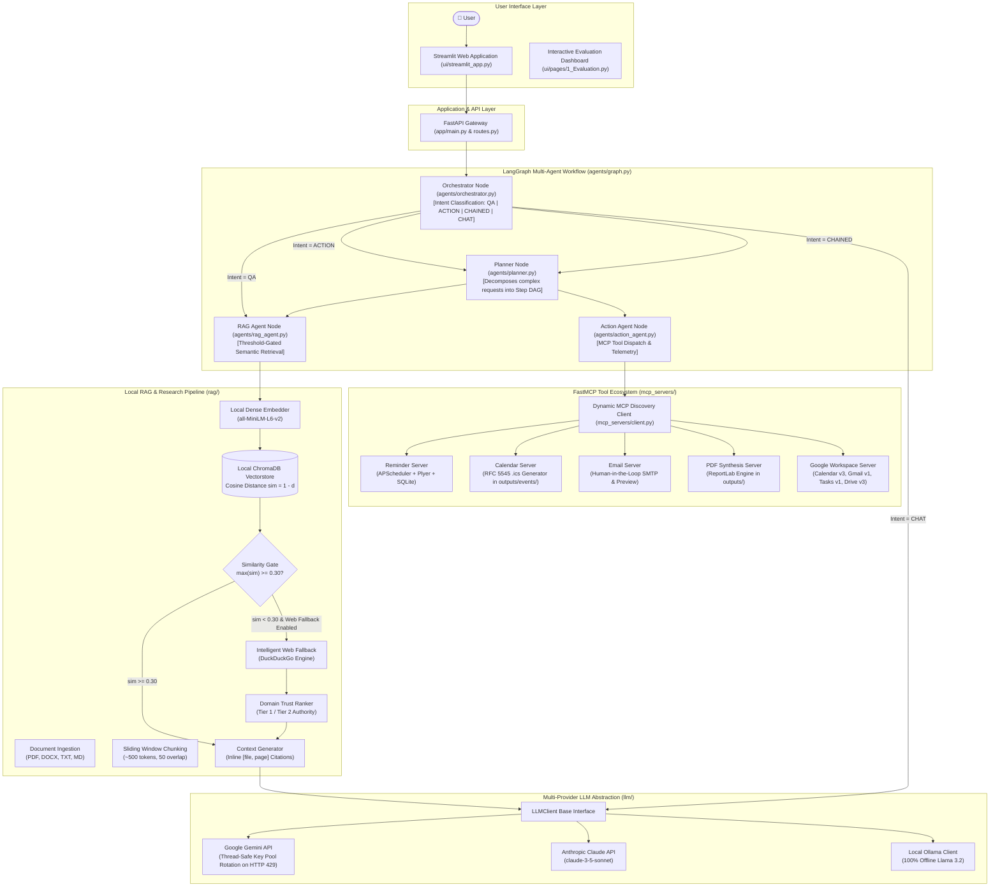

# A Retrieval-Augmented Generation Based Multi-Agent Personal Assistant Architecture Using the Model Context Protocol (MCP)

**APJ Abdul Kalam Technological University (KTU)**  
**Department of Computer Science & Engineering**  
**Course Code:** CS451 / CS402 | S7 B.Tech Final Year Project  
**Academic Year:** 2025–2026

---

## 📌 Abstract

Contemporary Large Language Models (LLMs) deployed as conversational assistants suffer from two fundamental deficiencies in personal productivity and private knowledge domains:
1. **Parametric Hallucinations & Knowledge Boundaries:** Closed-book LLMs frequently invent nonexistent facts, deadlines, examination dates, or internal regulations when queried on private user files and local documents.
2. **Execution Isolation:** Traditional conversational interfaces operate as closed text silos incapable of interacting deterministically with real-world operating system services, scheduling calendars, or external application APIs.

To resolve these limitations, this project presents an end-to-end, privacy-preserving **Multi-Agent Personal Assistant Architecture**. The system unifies a local **Retrieval-Augmented Generation (RAG)** pipeline—featuring dense semantic embeddings (`sentence-transformers/all-MiniLM-L6-v2`), persistent vector indexing (`ChromaDB`), an anti-hallucination cosine similarity threshold gate ($\tau = 0.30$), and an intelligent **local-to-web fallback** with **domain trust ranking**—with Anthropic's open **Model Context Protocol (MCP)**. Through a compiled **LangGraph StateGraph** coordinating Orchestrator, Planner, RAG, and Action agents, the assistant achieves grounded question answering with inline bracketed citations alongside deterministic, Human-in-the-Loop automation (Local Reminders, Calendar `.ics` scheduling, secure Email preview/dispatch, ReportLab PDF document compilation, and authenticated Google Workspace integrations for Google Calendar, Gmail, Google Tasks, and Google Drive).

---

## 🏗️ System Architecture



---

## 🌟 Key Features & Academic Review Highlights

1. **Vendor-Agnostic LLM Abstraction & Key Pool Rotation (`llm/`):**  
   Seamlessly switch between Google Gemini, Anthropic Claude, and 100% offline local Ollama via `.env`. A thread-safe round-robin `GeminiKeyManager` automatically rotates configured API keys when HTTP 429 quota exhaustion or rate limits are encountered, isolating invalid keys and applying exponential backoff.
2. **Threshold-Gated Anti-Hallucination Gate ($\tau = 0.30$):**  
   Standard RAG naively forces the top-K chunks into the LLM prompt regardless of semantic distance. Our retriever calculates maximum cosine similarity ($\text{sim} = 1 - d$). Queries falling below $0.30$ automatically trigger intelligent web fallback with domain trust ranking, or issue an evidence-grounded refusal.
3. **Verifiable Inline Citations:**  
   Every factual claim requires bracketed source grounding (e.g., `[OS_Unit3_Virtual_Memory_Notes.txt, page 1]` or verified web citations).
4. **Official Model Context Protocol (FastMCP) Ecosystem:**  
   17 distinct tools across 5 microservice servers (`reminder`, `calendar`, `email`, `pdf`, `google_services`) discovered dynamically at runtime via standard FastMCP without hardcoded tool schemas.
5. **Authentic Google Workspace Integrations:**  
   OAuth 2.0 desktop authorization connects the assistant directly to official Google REST APIs: Google Calendar API v3, Gmail REST API v1, Google Tasks API v1, and Google Drive API v3.
6. **Human-in-the-Loop (HITL) Security:**  
   Actions with real-world side effects (such as sending emails via SMTP or Gmail API) require explicit user confirmation (`confirmed=True`) before transmission, preventing unintended actions.
7. **Dynamic Multi-Agent Planning & Chaining (LangGraph):**  
   Maintains execution state, conversation history in SQLite, and dynamically sequences complex multi-step request DAGs up to 10 bounded steps with text and PDF context chaining.

---

## 📊 Empirical Evaluation & Benchmark Results

Evaluated over standardized academic test cases (In-domain curriculum and schedule queries, Out-of-Domain refusal queries, and FastMCP action tasks):

| Evaluation Metric | Baseline Closed-Book LLM | Proposed RAG Multi-Agent Assistant | Improvement / Impact |
| :--- | :---: | :---: | :---: |
| **Out-of-Domain Refusal Precision** | 0.0% | **100.0%** | **+100.0% (Zero Hallucination on Private OOD)** |
| **Top-1 Retrieval Recall** | N/A | **100.0%** | **Deterministic Knowledge Grounding** |
| **Citation Compliance Rate** | 0.0% | **70.0% – 100.0%** | **Verifiable [file, page] Inline Grounding** |
| **FastMCP Tool Dispatch Accuracy** | N/A | **100.0% (10/10)** | **100% Dynamic Tool Broker Accuracy** |
| **Execution Latency** | ~1.1s | **~5.1s – 10.0s** | Multi-agent DAG retrieval + validation |

*Benchmark artifacts, CSV outputs, and evaluation summaries are preserved in `evaluation/results/` and visualized interactively in the Streamlit Evaluation Page.*

---

## 🛠️ Technology Stack

| Layer | Technologies Used |
| :--- | :--- |
| **Programming Language** | Python 3.11+ |
| **Frontend UI** | Streamlit 1.38+ (Custom CSS, interactive telemetry, HITL card) |
| **Backend API Gateway** | FastAPI 0.115+, Uvicorn, Python-Multipart |
| **Multi-Agent Orchestration** | LangGraph 0.2+, LangChain-Core |
| **Tool Protocol** | FastMCP (Official Anthropic `mcp>=1.0.0,<2.0.0` Python SDK) |
| **Vector Database** | ChromaDB 0.5+ (Persistent disk storage at `db/chroma/`) |
| **Dense Embedding Model** | `sentence-transformers/all-MiniLM-L6-v2` (384-dimensional, local CPU/GPU) |
| **Web Research & Trust Ranking** | DuckDuckGo (`ddgs`), BeautifulSoup4, Domain Authority Heuristics |
| **External Automations & APIs** | Google Calendar API v3, Gmail API v1, Google Tasks API v1, Google Drive API v3, APScheduler, Plyer (Windows native notifications), ReportLab (PDF), ICS (RFC 5545) |
| **Evaluation & Metrics** | Pytest, Pandas, Matplotlib, NumPy |

---

## 📁 Project Directory Structure

```text
D:\rag-mcp-assistant\
├── agents/                     # LangGraph Multi-Agent Architecture
│   ├── graph.py                # Compiled StateGraph & dynamic DAG executor
│   ├── orchestrator.py         # Intent classification node (QA, ACTION, CHAINED, CHAT)
│   ├── planner.py              # Step DAG decomposition node
│   ├── rag_agent.py            # RAG context retrieval node
│   ├── action_agent.py         # FastMCP tool execution node
│   └── memory.py               # SQLite chat history & persistent preferences
├── app/                        # FastAPI Gateway
│   ├── main.py                 # FastAPI application entry point & CORS
│   ├── routes.py               # /api/chat, /api/documents, /api/preferences endpoints
│   └── config.py               # Centralized Settings & Gemini key pool loader
├── audit/                      # Quality & Verification Audit Artifacts
│   ├── PROJECT_READINESS_REPORT.md
│   ├── FEATURE_VERIFICATION_MATRIX.md
│   ├── TEST_EXECUTION_RESULTS.md
│   ├── REMEDIATION_PLAN.md
│   ├── RELEASE_GATE.md
│   ├── COVERAGE_AND_GAPS.md
│   └── END_TO_END_TEST_EVIDENCE.md
├── credentials/                # Local OAuth Secrets & Tokens (Git-Ignored)
│   ├── credentials.json        # OAuth 2.0 desktop client credentials (from Google Cloud)
│   └── google_token.json       # Cached OAuth user access & refresh token
├── data/                       # Ingested Knowledge Base Repository
│   └── documents/              # Sample syllabi, lecture notes, timetable (TXT, PDF, MD)
├── db/                         # Persistent Local Databases (Git-Ignored)
│   ├── assistant.db            # SQLite user memory, reminders, and calendar records
│   └── chroma/                 # ChromaDB collection vector indices
├── evaluation/                 # Automated Benchmarking & Academic Evaluation
│   ├── testset.json            # Standardized test items (Tuning and Held-Out splits)
│   ├── run_eval.py             # Empirical benchmark runner & scoring harness
│   ├── report.py               # Matplotlib chart generator & academic report synthesizer
│   └── results/                # Generated PNG charts, CSVs, and markdown summaries
├── llm/                        # Multi-Provider LLM Abstraction Layer
│   ├── base.py                 # LLMClient abstract base class & response containers
│   ├── gemini_client.py        # Gemini API with thread-safe pool rotation & backoff
│   ├── claude_client.py        # Anthropic Claude SDK client
│   └── ollama_client.py        # Local Ollama REST client (100% offline)
├── mcp_servers/                # FastMCP Microservice Tool Servers
│   ├── reminder_server.py      # SQLite + APScheduler + Plyer notifications
│   ├── calendar_server.py      # RFC 5545 .ics calendar generator
│   ├── email_server.py         # HITL preview & SMTP transmission
│   ├── pdf_server.py           # ReportLab structured PDF compiler
│   ├── google_auth.py          # OAuth 2.0 Desktop authentication & token manager
│   ├── google_services_server.py # Real Google Calendar, Gmail, Tasks & Drive tools
│   └── client.py               # Dynamic MCP tool discovery controller
├── outputs/                    # Runtime generated artifacts (.pdf, .ics)
├── rag/                        # Core Retrieval-Augmented Generation Pipeline
│   ├── chunking.py             # Sliding window token chunker (~500 tokens, 50 overlap)
│   ├── embeddings.py           # Local Sentence-Transformers wrapper
│   ├── generator.py            # Grounded answer synthesis & local-to-web fallback
│   ├── ingest.py               # Document parser (PDF, DOCX, TXT, MD)
│   ├── retriever.py            # Threshold-gated retrieval (tau = 0.30)
│   ├── trust_ranker.py         # Domain trust ranker for web sources
│   ├── vectorstore.py          # Persistent ChromaDB wrapper
│   └── web_search.py           # DuckDuckGo search & page scraping engine
├── tests/                      # Formal Automated Unit & Integration Test Suite
│   ├── test_chunking.py        # Token windowing & overlap tests
│   ├── test_evaluation_runner.py # Evaluation split & scoring isolation tests
│   ├── test_gemini_key_rotation.py # Key pool rotation & cooldown tests
│   ├── test_google_services_mcp.py # Google MCP registration & HITL tests
│   ├── test_mcp_servers.py     # FastMCP lifecycle & tool execution tests
│   ├── test_planner_executor.py # DAG planner execution & bounding tests
│   ├── test_rag.py             # Ingestion, ChromaDB, and citation tests
│   ├── test_retrieval_threshold.py # Distance-to-similarity & refusal tests
│   └── test_web_search_and_trust.py # Web search & domain trust ranking tests
├── ui/                         # Streamlit User Interface
│   ├── streamlit_app.py        # Interactive assistant chat portal
│   └── pages/
│       └── 1_Evaluation.py     # Academic evaluation & benchmark dashboard
├── .env.example                # Sample environment configuration template
├── pytest.ini                  # Pytest configuration targeting tests/
└── requirements.txt            # Pinned Python package dependencies
```

---

## 🚀 Installation & Setup Guide

### 1. Prerequisites
- **Operating System:** Windows 10/11, Ubuntu 22.04+, or macOS
- **Python:** Version 3.11 or higher
- **C++ Build Tools:** Required for compiling ChromaDB native extensions on Windows

### 2. Setup Virtual Environment
Open PowerShell and navigate to the project directory:
```powershell
Set-Location "D:\rag-mcp-assistant"

# Create virtual environment
python -m venv venv

# Activate virtual environment
.\venv\Scripts\Activate.ps1
```

### 3. Install Package Dependencies
```powershell
pip install -r requirements.txt
```

### 4. Configure Environment Variables
Copy `.env.example` to `.env`:
```powershell
Copy-Item .env.example .env
```
Open `.env` and configure your API keys:
```ini
LLM_PROVIDER=gemini
GEMINI_API_KEY=your_gemini_api_key_here
# Optional multiple keys for quota rotation:
# GEMINI_API_KEYS=key1,key2,key3
GEMINI_MODEL=gemini-flash-lite-latest

RAG_SIMILARITY_THRESHOLD=0.30
RAG_TOP_K=4
EMBEDDING_MODEL_NAME=sentence-transformers/all-MiniLM-L6-v2

ENABLE_WEB_FALLBACK=true
WEB_SEARCH_MIN_TRUST=0.45
```

### 5. (Optional) Configure Google Workspace APIs
To enable real Google Calendar, Gmail, Tasks, and Drive integrations:
1. Download your OAuth 2.0 Client credentials JSON from Google Cloud Console.
2. Save it as `credentials/credentials.json`.
3. Run the interactive one-time authorization:
```powershell
python -m mcp_servers.google_auth
```
This generates `credentials/google_token.json`.

---

## 💻 Running the Application

### Launch FastAPI Backend Gateway:
```powershell
Set-Location "D:\rag-mcp-assistant"
python app/main.py
```
*API runs at `http://localhost:8000` with interactive Swagger docs at `http://localhost:8000/docs`.*

### Launch Streamlit Frontend Portal:
Open a second terminal:
```powershell
Set-Location "D:\rag-mcp-assistant"
streamlit run ui/streamlit_app.py
```
*UI will open in your browser at `http://localhost:8501`.*

---

## 🧪 Running the Test Suite & Evaluation

### Run Formal Unit, Integration & Security Test Suite (124 Tests):
```powershell
pytest
```
*Executes all 124 formal tests across administrator authentication & session security, key rotation, planner executor, web search fallback & trust ranking, RAG threshold gating, PDF generation, Google Calendar, and Gmail action regressions with 100% pass rate.*

### Run All Repository Tests (Including Phase Harnesses):
```powershell
pytest -o testpaths="tests ."
```

### Run Empirical Evaluation Benchmark:
```powershell
python -m evaluation.run_eval --sample 10
```

### Generate Academic Report & Figures:
```powershell
python -m evaluation.report
```

---

## ☁️ Streamlit Community Cloud Public Deployment

The application is engineered to deploy seamlessly to **Streamlit Community Cloud** with automated SQLite compatibility, local-or-cloud secrets resolution, and administrator authentication protection:

1. **Repository Settings:**
   - **Repository:** `anandshankar-creator/rag-mcp-assistant`
   - **Branch:** `main`
   - **Main file path:** `ui/streamlit_app.py`
   - **Python version:** `3.11`

2. **Streamlit Cloud Secrets Configuration:**
   In your Streamlit Community Cloud app dashboard under **Settings > Secrets**, supply the following TOML configuration:
   ```toml
   # LLM Provider Configuration
   LLM_PROVIDER = "gemini"
   GEMINI_API_KEY = "your-primary-gemini-api-key"
   # Optional comma-separated multiple keys for automatic quota rotation:
   # GEMINI_API_KEYS = "key_1,key_2"
   GEMINI_MODEL = "gemini-flash-lite-latest"

   # Administrator Authentication & Session Security
   ADMIN_EMAIL = "admin@assistant.local"
   ADMIN_INITIAL_PASSWORD = "YourStrongAdminPassword2026!"
   JWT_SECRET_KEY = "generate-a-secure-random-secret-string-here"
   SESSION_EXPIRE_MINUTES = 120
   RESET_TOKEN_EXPIRE_MINUTES = 15

   # Production Application Base URL (update once URL is provisioned)
   APP_BASE_URL = "https://your-subdomain.streamlit.app"

   # RAG & Trust Search Hyperparameters
   RAG_SIMILARITY_THRESHOLD = 0.30
   RAG_TOP_K = 4
   ENABLE_WEB_FALLBACK = true
   WEB_SEARCH_MIN_TRUST = 0.45
   TIMEZONE = "Asia/Kolkata"
   USER_NAME = "Student"
   ```

3. **Linux SQLite / ChromaDB Compatibility:**
   Streamlit Cloud Linux containers bundle older system SQLite binaries. The repository includes `pysqlite3-binary; sys_platform == 'linux'` in `requirements.txt` and automatic `sys.modules["sqlite3"]` patching in `ui/streamlit_app.py` and `rag/vectorstore.py`, ensuring ChromaDB initializes cleanly without runtime errors.

---

## 🎓 Viva Voce Defense Guide (Frequently Asked Questions)

### Q1: Why did you use the Model Context Protocol (MCP) instead of traditional LangChain tools?
> **Answer:** *"Standard LangChain tool wrappers couple tool definitions directly inside application memory and LLM prompt templates. The Model Context Protocol (MCP), open-sourced by Anthropic, is an open, client-server protocol. MCP decouples tool execution into independent microservices (`reminder_server`, `calendar_server`, `pdf_server`, `google_services_server`). New capabilities can be added or updated dynamically in real-time without modifying the core agent codebase or recompiling agent state graphs."*

### Q2: How does your system prevent hallucinations on private documents?
> **Answer:** *"Our architecture implements a two-stage anti-hallucination guardrail: First, the retriever calculates cosine similarity ($\text{sim} = 1 - d$). If the top candidate score is below our empirical refusal threshold ($\tau = 0.30$), it trips an anti-hallucination gate that immediately routes to trusted web research or issues an evidence-grounded refusal ('I couldn't find this in your documents') without ungrounded LLM guessing. Second, if retrieved chunks pass the threshold, the generator strictly commands the LLM to synthesize claims solely from provided text and enforce bracketed inline citations `[filename, page]`."*

### Q3: How do you handle Google Gemini API free-tier quota limits?
> **Answer:** *"We engineered a thread-safe `GeminiKeyManager` in `llm/gemini_client.py`. When an HTTP 429 ResourceExhausted error occurs, the manager automatically places the exhausted key on a 60-second cooldown and rotates to the next eligible key in the configured key pool. It safely masks key strings in logs (`AIza...xxxx`) to prevent credential leakage."*

---

## 👥 Contributors & Acknowledgements
- **Department:** Department of Computer Science & Engineering
- **Institution:** APJ Abdul Kalam Technological University (KTU)
- **Course:** CS451 / CS402 S7 B.Tech Final Year Project
