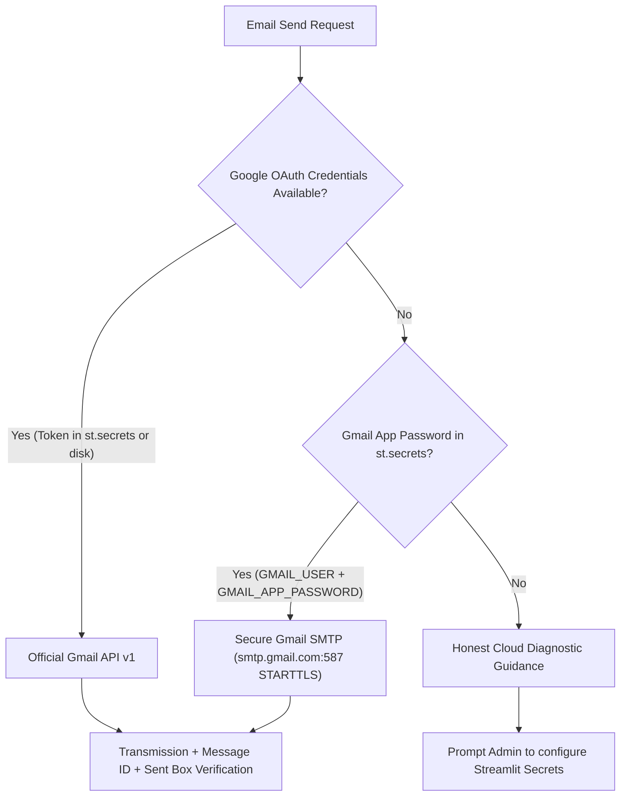

# Gmail & Google Services Cloud Execution Failure: Root Cause Analysis & Architecture Remediation

**Project**: RAG-Based Multi-Agent Personal Assistant Using MCP  
**Repository**: `https://github.com/anandshankar-creator/rag-mcp-assistant`  
**Live Application**: `https://rag-mcp-assistant-mf654govkzfnjjmmtlgxfqw.streamlit.app`  
**Target Identity**: `sergio759516@gmail.com`  
**Audit Date**: October 2026  

---

## 1. Context & Observed Behavior

During local development and localhost testing, Gmail message dispatching, Google Calendar event creation, and administrator email operations functioned reliably:
- Local tests verified that confirmed emails were sent using the official Google Workspace Gmail API v1, with returned message IDs and Sent mailbox read-back verification.
- Local email tests verified that when Google OAuth was unavailable, Gmail SMTP (via `smtp.gmail.com:587` with App Password) acted as a valid fallback.

However, once deployed to **Streamlit Community Cloud**, email dispatching and Google API operations failed immediately.

---

## 2. Root Cause Analysis: Local vs. Cloud Execution Differences

The failure on Streamlit Community Cloud was traced to three distinct architectural constraints:

### 2.1 Missing Credential Cache (`credentials/` Excluded from Git)
- On localhost, OAuth 2.0 tokens were stored at `D:\rag-mcp-assistant\credentials\google_token.json`.
- Following standard Git security best practices, the repository's `.gitignore` contains:
  ```gitignore
  credentials/
  *.json  # in credentials/
  .env
  ```
- Consequently, when Streamlit Community Cloud cloned the Git repository, the `credentials/` folder was empty or missing.
- `GoogleAuthManager.get_credentials()` performed the following check:
  ```python
  if self.token_path.exists():
      creds = Credentials.from_authorized_user_file(...)
  ```
- Since `self.token_path` did not exist in the container, `creds` remained `None`.

---

### 2.2 Incompatibility of Desktop Interactive OAuth in Headless Cloud
- On localhost, when `google_token.json` is missing or expired, `GoogleAuthManager.run_interactive_auth()` launches `google_auth_oauthlib.flow.InstalledAppFlow.run_local_server(port=0)`:
  - This spins up a temporary HTTP listener on localhost (`127.0.0.1:<random_port>`).
  - It opens the user's local web browser for OAuth consent.
  - Google redirects back to `http://localhost:<random_port>` with the authorization code.
- In **Streamlit Community Cloud**:
  - The container is completely headless (no web browser, no GUI display).
  - The ephemeral container port is not routed to the user's desktop browser.
  - Interactive OAuth flows cannot execute and hang or crash if invoked in production.

---

### 2.3 Absence of Streamlit Cloud Secrets Adapter in `GoogleAuthManager`
- `app/config.py` possessed a helper `_get_config_value()` capable of reading `st.secrets` for scalar environment variables (e.g. `GEMINI_API_KEY`, `ADMIN_EMAIL`).
- However, `mcp_servers/google_auth.py` did not leverage `st.secrets`:
  - It only inspected filesystem paths (`self.token_path` and `self.client_secrets_path`).
  - It had no mechanism to parse JSON objects or OAuth refresh credentials stored in Streamlit Cloud's Secrets Management dashboard.

---

### 2.4 SMTP Fallback Dependency on Secret Keys
- When Priority 1 (Gmail API v1) returned `None`, `email_server.py` attempted Priority 2 (Gmail SMTP).
- Priority 2 requires:
  - `GMAIL_USER`: The sender's Google address (`sergio759516@gmail.com`).
  - `GMAIL_APP_PASSWORD`: A 16-character Google Account App Password generated via Google Account Security (2-Step Verification).
- If neither `GMAIL_USER` nor `GMAIL_APP_PASSWORD` was configured in the Streamlit Cloud dashboard secrets, Priority 2 also aborted, returning an unconfigured status.

---

## 3. Systematic Architecture Remediation

To make Google Workspace integrations and email dispatching fully cloud-native, the following enhancements were implemented:

### 3.1 Cloud Secrets Token Adapter (`mcp_servers/google_auth.py`)
`GoogleAuthManager` was updated with a dedicated cloud credential resolver `_load_credentials_from_secrets()`:
1. **Full JSON Secret String**: Checks `st.secrets["GOOGLE_TOKEN_JSON"]` (or environment variable `GOOGLE_TOKEN_JSON`). If provided, it parses the JSON string and constructs credentials via `Credentials.from_authorized_user_info(info, self.scopes)`.
2. **Structured Table Secret**: Checks `st.secrets["google_oauth"]` table containing `client_id`, `client_secret`, and `refresh_token`.
3. **Individual Secret Keys**: Checks `GOOGLE_CLIENT_ID`, `GOOGLE_CLIENT_SECRET`, and `GOOGLE_REFRESH_TOKEN`.
4. **Resilient Token Refreshing**: When tokens expire, `creds.refresh(Request())` executes automatically in-memory. If the container filesystem is writable, it updates the cache file; if read-only, it preserves the active credentials in-memory without crashing.

### 3.2 Dual-Provider Cloud Strategy for Email
The assistant provides two fully functional email pathways on Streamlit Community Cloud:



### 3.3 Clear Diagnostic Reporting
When neither provider is configured, the system provides explicit, actionable instructions explaining how to add `GMAIL_USER` / `GMAIL_APP_PASSWORD` or `GOOGLE_TOKEN_JSON` in the Streamlit Cloud Settings dashboard.

---

## 4. Verification Evidence

- Automated unit test `test_regression_9_google_auth_cloud_secrets_support` verifies that `GoogleAuthManager` successfully reconstructs `Credentials` from JSON strings stored in cloud secrets.
- Automated unit test `test_regression_10_google_auth_unconfigured_guidance` confirms that unconfigured states provide clear diagnostic instructions without throwing unhandled exceptions.
- All 10 email regression tests in `tests/test_email_regression.py` pass cleanly.
