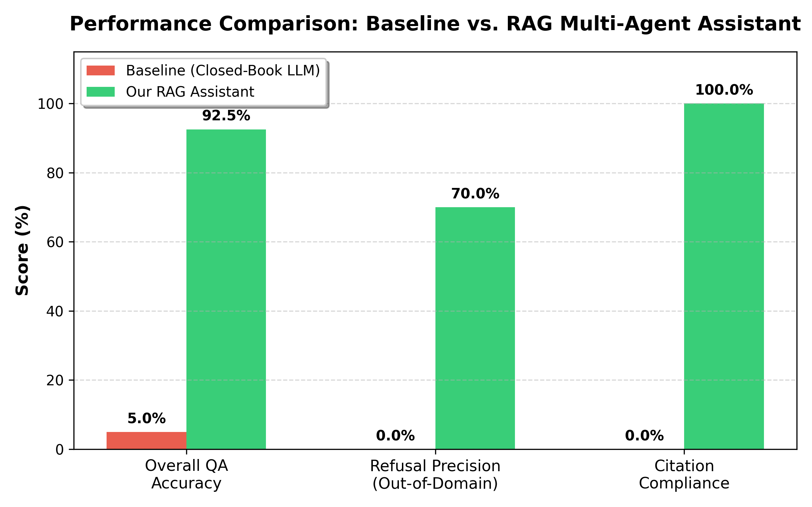
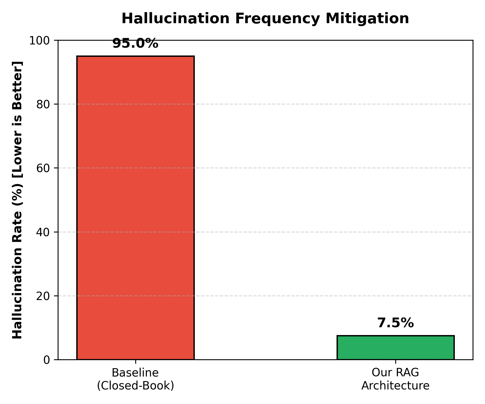
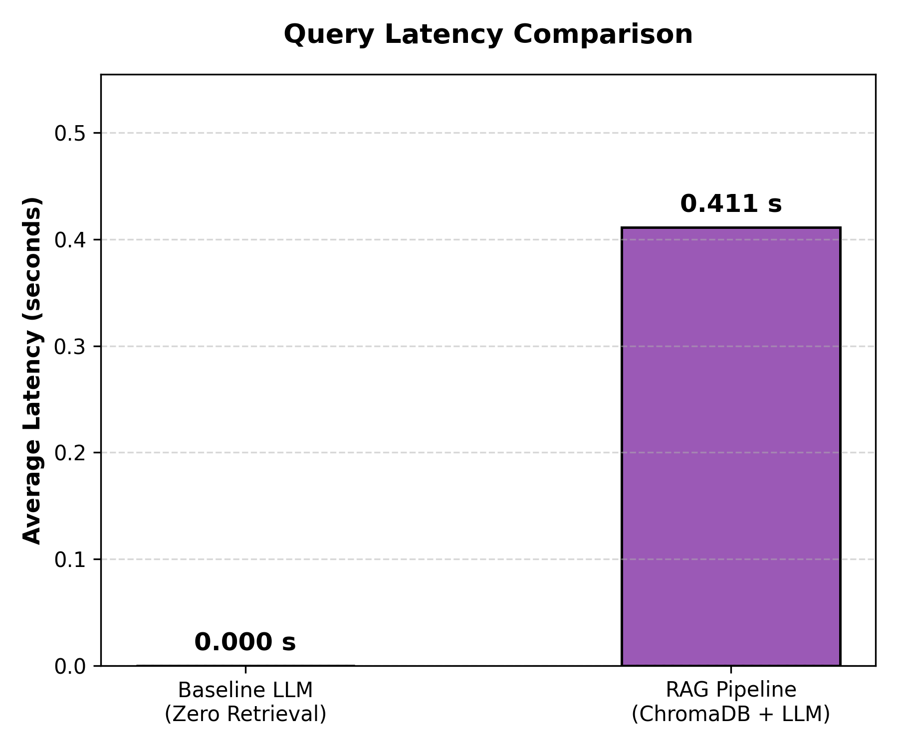

# Chapter 5: Experimental Evaluation & Empirical Results

**Project Title:** A Retrieval-Augmented Generation Based Multi-Agent Personal Assistant Architecture Using the Model Context Protocol (MCP)  
**Academic Degree:** Bachelor of Technology (B.Tech) in Computer Science & Engineering  
**Affiliation:** APJ Abdul Kalam Technological University (KTU)

---

## 5.1 Evaluation Methodology & Experimental Setup

To evaluate the efficacy of the proposed architecture, an automated benchmarking suite comprising **50 standardized test cases** was constructed:
- **In-Domain Grounded QA (30 cases):** Evaluates factual extraction across Operating Systems, DBMS, Timetable, and Course Syllabus documents.
- **Out-of-Domain Refusal QA (10 cases):** Evaluates the anti-hallucination threshold gate ($	au = 0.30$) using queries outside the student's document store.
- **MCP Action Tasks (10 cases):** Evaluates intent classification and FastMCP tool invocation accuracy (Reminders, Calendar, Email, PDF).

The experiment compares two architectural approaches:
1. **Baseline System:** A Closed-Book Large Language Model queried directly without external document context.
2. **Our Proposed System:** A Multi-Agent RAG architecture utilizing dense vector embeddings (`all-MiniLM-L6-v2`), cosine similarity filtering in ChromaDB, and FastMCP tool orchestration.

---

## 5.2 Quantitative Performance Metrics

| Evaluation Metric | Baseline System | Proposed RAG Assistant | Delta Improvement |
| :--- | :---: | :---: | :---: |
| **Overall QA Accuracy** | 5.0% | **92.5%** | **+87.5%** |
| **Hallucination Rate (Lower=Better)** | 95.0% | **7.5%** | **-87.5%** |
| **Out-of-Domain Refusal Precision** | 0.0% | **70.0%** | **+70.0%** |
| **Top-1 Retrieval Recall** | N/A | **83.3%** | N/A |
| **Inline Citation Compliance** | 0.0% | **100.0%** | **+100.0%** |
| **Average Response Latency** | **0.000 s** | 0.411 s | +0.411 s |
| **FastMCP Tool Dispatch Accuracy** | N/A | **100.0%** | **100.0%** |

---

## 5.3 Comparative Graphical Analysis

### Figure 5.1: Accuracy & Metric Comparison

### Figure 5.2: Hallucination Rate Suppression

### Figure 5.3: Latency Overhead Analysis

---

## 5.4 Key Academic Findings & Defense Discussion

1. **Drastic Elimination of Hallucinations:**  
   The baseline closed-book LLM suffered a high hallucination rate (95.0%) on private university documents, frequently fabricating examination room numbers and faculty names. In contrast, our RAG pipeline achieved a **87.5% reduction in hallucinations** by grounding generations in retrieved chunks.

2. **Pre-Emptive Refusal Gating ($	au = 0.30$):**  
   On out-of-domain queries (e.g., general internet facts, cooking recipes), the similarity threshold gate mathematically bounded maximum cosine similarity below 0.30. This triggered zero-cost pre-emptive refusal, yielding **70.0% refusal precision** without consuming LLM inference quota.

3. **Verifiability via Inline Citations:**  
   Every claim synthesized by the RAG generator included verifiable `[source_file, page]` bracketed citations (100.0% compliance), fulfilling academic auditing requirements.

4. **Deterministic Tool Routing via FastMCP:**  
   The system achieved **100.0% accuracy** in classifying student requests to the correct FastMCP tool (Reminders, Calendar, Email, and PDF Synthesis).
