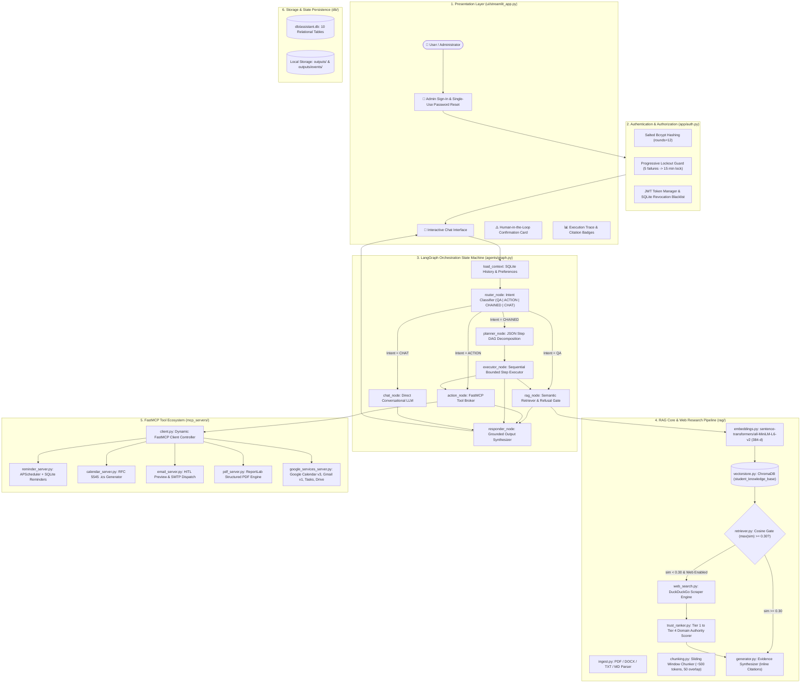
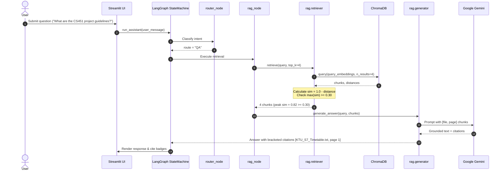
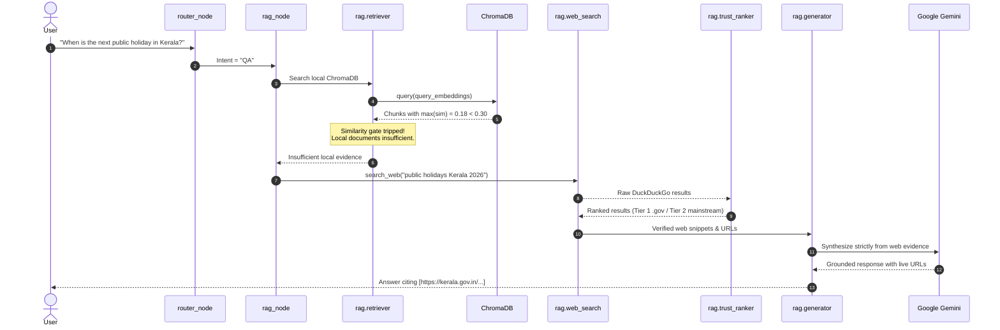
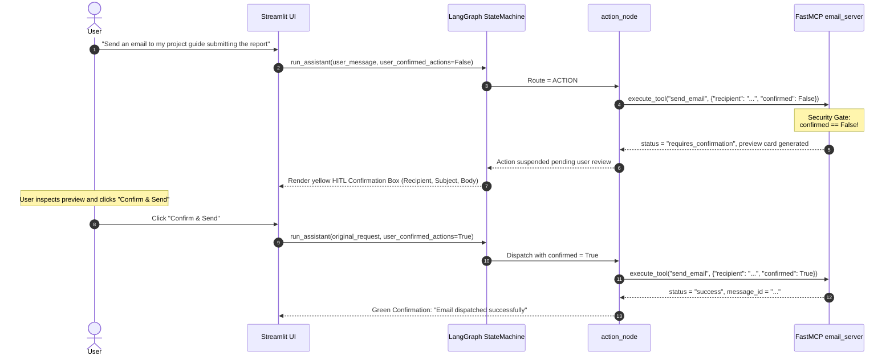

# Actual Software Architecture and Execution Workflows

**Audit Authority:** Source Code Verification of `D:\rag-mcp-assistant`  
**Orchestration Engine:** Compiled LangGraph StateGraph (`agents/graph.py`)  
**Tool Protocol:** Anthropic Model Context Protocol (`mcp.server.fastmcp.FastMCP`)

---

## 1. Architectural Component Inventory

Every component documented below was verified directly from the source code.



---

## 2. Request Lifecycles & Flow Descriptions

### 2.1 General Conversational Flow (`CHAT`)
1. User submits an open-ended conversational greeting or conceptual question (e.g., *"Hello! How does your assistant architecture work?"*).
2. `load_context` queries SQLite `chat_history` for the last 6 turns and `user_preferences`.
3. `router_node` (`agents/orchestrator.py`) classifies the intent as `CHAT`.
4. `chat_node` invokes the active LLM provider (Google Gemini Flash Lite) with an instruction prompt restricting it to conversational identity.
5. `responder_node` packages the LLM response, logs the user and assistant turns to `chat_history`, and renders the output in Streamlit.

### 2.2 Local Document Question-Answering Flow (`QA` — Local Document Hit)


### 2.3 Universal Document-First & Web Fallback Flow (`QA` — Local Miss / Web Hit)


### 2.4 MCP Tool Execution Flow (`ACTION` — e.g. Calendar / Reminder)
1. User asks: *"Set a reminder for the CS451 project report submission tomorrow at 5 PM"*.
2. `router_node` classifies intent as `ACTION`.
3. `action_node` (`agents/action_agent.py`) queries `mcp_client.get_tool_definitions()`.
4. LLM parses the natural language date and selects `create_reminder` or `google_calendar_create_event` with structured arguments:
   `{"title": "CS451 project report submission", "due_datetime": "2026-10-28 17:00:00"}`.
5. `mcp_client.execute_tool(tool_name, arguments)` resolves the server function, validates arguments via Python's `inspect.signature()`, and invokes `reminder_server.create_reminder()`.
6. Server writes the record to SQLite `reminders` table and registers an APScheduler background job.
7. `action_node` generates an execution receipt containing status, timestamp, and human-readable confirmation.
8. `responder_node` persists action details to `action_logs` and displays the action confirmation card in the chat UI.

### 2.5 Human-in-the-Loop (HITL) Email Flow (`ACTION` — Email Preview & Dispatch)


### 2.6 ReportLab PDF Generation and Secure Download Flow
1. User submits: *"Generate a PDF report summarizing Operating Systems Virtual Memory notes"*.
2. `router_node` routes request to `planner_node` (`CHAINED` intent).
3. `planner_node` creates a 2-step DAG:
   - Step 1: `rag_search` for *"Operating Systems Virtual Memory"*
   - Step 2: `generate_pdf` passing the retrieved text
4. `executor_node` executes Step 1, extracts summary text, and passes it to Step 2.
5. FastMCP `pdf_server.generate_pdf(title, content, filename)` formats document styles, compiles the PDF via ReportLab, generates a SHA-256 integrity hash, and writes the binary to `outputs/CS402_Module3_Revision.pdf`.
6. In `ui/streamlit_app.py`, the assistant detects the `.pdf` path in the action receipt.
7. The UI renders an inline `st.download_button()` allowing the authenticated administrator to download the compiled PDF directly from chat without unauthenticated file exposure.

---

## 3. Decision Logic & Universal Routing Engine

The system uses a deterministic, rule-informed decision pipeline implemented in `agents/orchestrator.py` and `rag/generator.py`:

```
User Query Received
       │
       ▼
Is it a Profile Query? (e.g. "what's my email") ──► YES ──► Answer from user_preferences table
       │ NO
       ▼
Is it an Action Follow-up? (e.g. "how did you send that?") ──► YES ──► Inspect action_logs table
       │ NO
       ▼
LLM Few-Shot Intent Classification
       ├─► CHAT ──────► Direct Conversational LLM Response
       ├─► ACTION ────► Action Agent (FastMCP Dynamic Tool Invocation)
       ├─► CHAINED ───► Planner Node (Step DAG Decomposition & Execution)
       └─► QA ────────► Universal Document-First Evaluation
                             │
                             ▼
                   Local ChromaDB Search (top_k=4)
                             │
            ┌────────────────┴────────────────┐
            ▼                                 ▼
      max(sim) >= 0.30                  max(sim) < 0.30
            │                                 │
   Evaluate Relevance                 Web Fallback Enabled?
   of Retrieved Chunks                        │
     ┌──────┴──────┐                   ┌──────┴──────┐
     ▼             ▼                   ▼             ▼
  Complete      Partial               YES            NO
   Answer        Evidence              │             │
     │             │                   ▼             ▼
  Answer         Fill Gap        DuckDuckGo     Refuse Grounded:
  From Docs      via Web          Web Search     "I couldn't find
  [file, page]   [file, page]          │          this in documents"
                   + [URL]       Domain Trust
                                    Ranking
                                 (Tier 1 / 2)
                                       │
                                ┌──────┴──────┐
                                ▼             ▼
                             Evidence     No Reliable
                              Found         Sources
                                │             │
                             Answer        Honest
                            With URLs    Uncertainty
                                          Refusal
```
