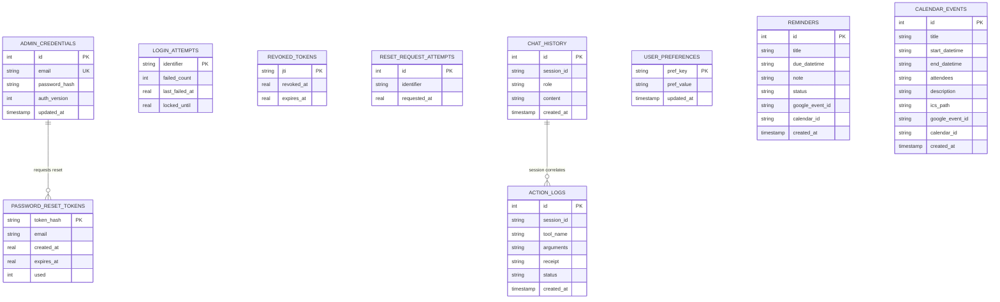

# Database, Memory, & External Integrations

**Audit Authority:** Source Code Verification of `D:\rag-mcp-assistant\db\` and `D:\rag-mcp-assistant\mcp_servers\`  
**Primary Relational Database:** SQLite 3 (`db/assistant.db`) — 10 Verified Relational Tables  
**Vector Database:** ChromaDB (`db/chroma/`) — Collection `student_knowledge_base`  
**Authentication Standard:** Salted Bcrypt Hashing, JWT Sessions, Single-Use SHA-256 Reset Tokens  
**External Cloud APIs:** Google Calendar API v3, Gmail REST API v1, Google Tasks API v1, Google Drive API v3

---

## 1. SQLite Database Architecture (`db/assistant.db`)

All persistent structured state—including conversational memory, student preferences, scheduled tools, action telemetry, administrator credentials, and session tokens—is stored in a single, lightweight SQLite database file at `db/assistant.db`.

---

## 2. Verified Relational Tables & Schema Inventory

| Table Name | Defined In | Primary Key | Key Columns & Types | Purpose in Architecture |
|---|---|---|---|---|
| `admin_credentials` | [`app/auth.py`](file:///D:/rag-mcp-assistant/app/auth.py#L65) | `id` (int) | `email` (str, unique), `password_hash` (str), `auth_version` (int), `updated_at` (ts) | Stores single administrator account with salted bcrypt hash and monotonic version counter |
| `login_attempts` | [`app/auth.py`](file:///D:/rag-mcp-assistant/app/auth.py#L76) | `identifier` (str) | `failed_count` (int), `last_failed_at` (real), `locked_until` (real) | Enforces progressive brute-force lockout (5 failed attempts $\rightarrow$ 15-min lockout) |
| `password_reset_tokens` | [`app/auth.py`](file:///D:/rag-mcp-assistant/app/auth.py#L86) | `token_hash` (str) | `email` (str), `created_at` (real), `expires_at` (real), `used` (int) | Stores SHA-256 hash of single-use reset tokens (15-min expiration window; raw tokens never stored) |
| `revoked_tokens` | [`app/auth.py`](file:///D:/rag-mcp-assistant/app/auth.py#L97) | `jti` (str) | `revoked_at` (real), `expires_at` (real) | Blacklist of revoked JWT token identifiers (`jti`) upon explicit administrator logout |
| `reset_request_attempts` | [`app/auth.py`](file:///D:/rag-mcp-assistant/app/auth.py#L106) | `id` (int) | `identifier` (str), `requested_at` (real) | Enforces rate limiting on password reset requests (maximum 3 requests per 15 minutes) |
| `chat_history` | [`agents/memory.py`](file:///D:/rag-mcp-assistant/agents/memory.py#L40) | `id` (int) | `session_id` (str), `role` (str: user/assistant), `content` (str), `created_at` (ts) | Preserves multi-turn conversation history injected into LangGraph agent state |
| `user_preferences` | [`agents/memory.py`](file:///D:/rag-mcp-assistant/agents/memory.py#L50) | `pref_key` (str) | `pref_value` (str), `updated_at` (ts) | Stores profile preferences (`name`, `email`, `default_reminder_lead_hours`) |
| `action_logs` | [`agents/memory.py`](file:///D:/rag-mcp-assistant/agents/memory.py#L58) | `id` (int) | `session_id` (str), `tool_name` (str), `arguments` (str), `receipt` (str), `status` (str) | Audit trail of executed MCP tools enabling historical follow-up query answering |
| `reminders` | [`mcp_servers/db.py`](file:///D:/rag-mcp-assistant/mcp_servers/db.py#L37) | `id` (int) | `title` (str), `due_datetime` (str), `note` (str), `status` (str), `google_event_id` (str) | Persists local APScheduler reminders and correlates them to synced Google events |
| `calendar_events` | [`mcp_servers/db.py`](file:///D:/rag-mcp-assistant/mcp_servers/db.py#L49) | `id` (int) | `title` (str), `start_datetime` (str), `end_datetime` (str), `ics_path` (str), `google_event_id` (str) | Persists generated RFC 5545 `.ics` events and Google Calendar synchronization IDs |

---

## 3. External Cloud Services & Tool Integrations

### 3.1 Google Workspace OAuth 2.0 Desktop Integration
Implemented in [`mcp_servers/google_auth.py`](file:///D:/rag-mcp-assistant/mcp_servers/google_auth.py) and [`mcp_servers/google_services_server.py`](file:///D:/rag-mcp-assistant/mcp_servers/google_services_server.py):

| Service | API & Scopes | Operations Implemented | Security & Verification Mechanics |
|---|---|---|---|
| **Google Calendar** | Google Calendar API v3 `https://www.googleapis.com/auth/calendar` | `google_calendar_create_event` `google_calendar_list_events` | - Enforces `Asia/Kolkata` (+05:30) timezone. - **Duplicate Prevention:** Scans existing events for matching title and time before creating a new entry. - **Read-Back Verification:** Queries Google API to confirm event presence and returns real `html_link`. |
| **Google Gmail** | Gmail REST API v1 `https://www.googleapis.com/auth/gmail.send` `https://www.googleapis.com/auth/gmail.readonly` | `google_gmail_send_message` `google_gmail_list_messages` | - **HITL Confirmation Gate:** If `confirmed != True`, returns preview and halts transmission. - **Duplicate Guard:** Inspects recent sent messages within a 120-second window. - Records verified `message_id` and `thread_id`. |
| **Google Tasks** | Google Tasks API v1 `https://www.googleapis.com/auth/tasks` | `google_tasks_create` `google_tasks_list` | Creates and lists tasks directly in the user's primary Google Tasks list. |
| **Google Drive** | Google Drive API v3 `https://www.googleapis.com/auth/drive.metadata.readonly` | `google_drive_search` | Searches files and metadata in user's Google Drive. |

### 3.2 ReportLab PDF Synthesis Integration
Implemented in [`mcp_servers/pdf_server.py`](file:///D:/rag-mcp-assistant/mcp_servers/pdf_server.py):
- Compiles formal academic notes, timetables, and summaries into PDF documents using `reportlab.platypus` (`SimpleDocTemplate`, `Paragraph`, `Spacer`, `Table`).
- **Filename Sanitization:** Stems filenames, strips directory traversal characters (`../`, `\`), and enforces `.pdf` extension.
- **Integrity Hash:** Generates and embeds a SHA-256 cryptographic digest of the generated PDF in metadata and returns it in the tool receipt.
- **Secure Delivery:** Renders directly into chat via an in-memory `st.download_button()` accessible only to authenticated administrators.

### 3.3 RFC 5545 Standard Calendar Integration (`.ics`)
Implemented in [`mcp_servers/calendar_server.py`](file:///D:/rag-mcp-assistant/mcp_servers/calendar_server.py):
- Uses the Python `ics` library to construct standard iCalendar files.
- Writes files to `outputs/events/event_{id}_{slug}.ics`.
- Can be imported into Microsoft Outlook, Apple Calendar, Google Calendar, or mobile devices offline without network access.

### 3.4 APScheduler Local OS Notifications
Implemented in [`mcp_servers/reminder_server.py`](file:///D:/rag-mcp-assistant/mcp_servers/reminder_server.py):
- Background `BackgroundScheduler` checks due dates.
- Triggers native desktop notifications using `plyer.notification.notify()`.
- Updates reminder record status from `'pending'` to `'fired'` in SQLite.
